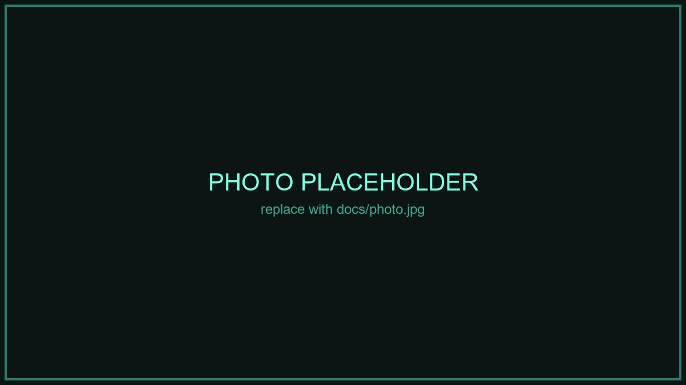
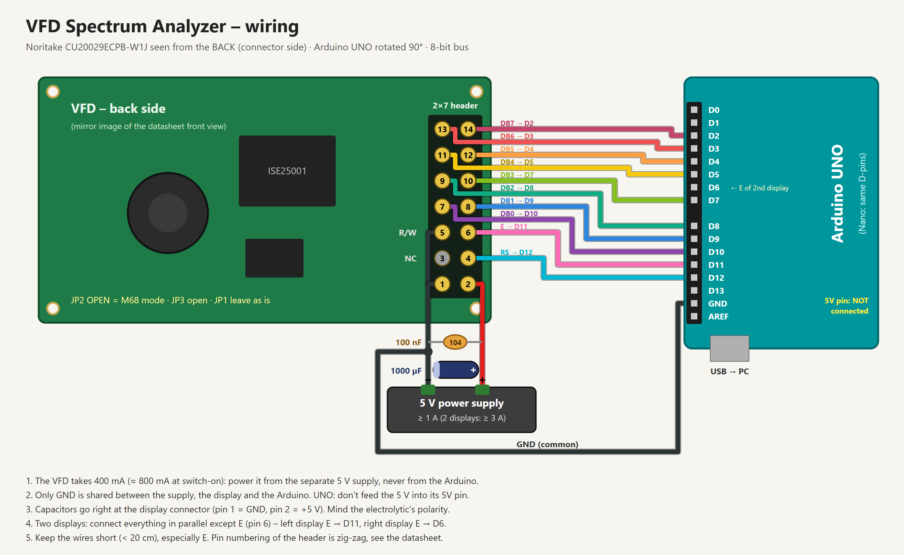
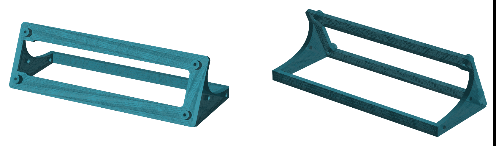
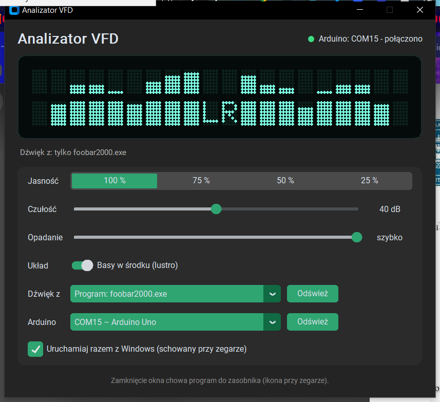

# VFD Spectrum Analyzer

Stereo audio spectrum analyzer on a **Noritake CU20029ECPB-W1J** 2×20 vacuum fluorescent display,
driven by an Arduino. The PC does the audio capture and FFT, the Arduino just draws the bars,
so there is no analog input circuit at all. Audio comes over USB.


- **9 log-spaced bands per channel** (40 Hz – 16 kHz), left + right, bass in the middle (mirrored) or on the left
- **Whole system audio or just one program** (e.g. only foobar2000, without game / browser sounds)
- **Windows GUI** with a live dot-matrix preview, brightness (4 levels), sensitivity, decay, tray icon, autostart
- Auto gain, auto reconnect when the Arduino is unplugged, port picker when several boards are connected
- One or **two displays** (left / right channel), 3D-printable desk stand included

These displays turn up cheap in scrapped **POSNET** fiscal cash registers. There is almost no info about
them online, so the pitfalls we hit are written down below.



## How it works

```
 PC (Windows)                                        Arduino UNO / Nano        VFD 20x2
 ┌───────────────────────────────────────┐   USB    ┌──────────────────┐ 8-bit ┌──────────────┐
 │ WASAPI loopback (system or one app)   │ ───────► │ parse frame,     │ ────► │ ▂▅█ LR █▅▂│
 │ → FFT → 9+9 bands → auto gain → decay │ 40 fps   │ draw CGRAM bars  │  bus  └──────────────┘
 └───────────────────────────────────────┘          └──────────────────┘
```

Serial frame, 115200 baud: `0xFF`, 9 bands L, 9 bands R (0–16), VU L, VU R (0–8), brightness (0–3).

## Hardware

| Part | Notes |
|---|---|
| Noritake CU20029ECPB-W1J (or -U1J) | 2×20, HD44780-compatible, 5 V, **400 mA typ.** |
| Arduino UNO or Nano | Nano is nicer for a permanent build (see below) |
| 5 V power supply | ≥ 1 A for one display, ≥ 3 A for two |
| 1000 µF (≥ 10 V) + 100 nF per display | right at the display connector |
| 14-pin ribbon cable / 2×7 IDC, or jumper wires | keep it short |



A real photo of the display plus Fritzing parts, all to scale. 1000 µF + 100 nF sit across the breadboard rails, as close to the display as you can. The display is shown from the **back** (the side you plug the wires into), so the header is a mirror
image of the datasheet's front view.

### Wiring

| VFD pin | Signal | Arduino | Wire in the picture |
|---|---|---|---|
| 1 | GND | GND rail (supply **and** Arduino GND) | black |
| 2 | +5 V | +5 V rail, **external supply only** | red |
| 3 | NC | – | – |
| 4 | RS | D12 | cyan |
| 5 | R/W | GND rail | black |
| 6 | E | D11 (left display), D6 (right display) | pink |
| 7 | DB0 | D10 | purple |
| 8 | DB1 | D9 | blue |
| 9 | DB2 | D8 | teal |
| 10 | DB3 | D7 | green |
| 11 | DB4 | D5 | yellow |
| 12 | DB5 | D4 | orange |
| 13 | DB6 | D3 | red-orange |
| 14 | DB7 | D2 | magenta |

The 2×7 header is numbered zig-zag: odd pins in one row, even pins in the other.
With two displays, everything is shared except **E**.

### Jumpers on the display

- **JP2 open** = M68 (HD44780) bus mode. This is what `LiquidCrystal` expects. Soldered = i80, won't work.
- **JP3 open**: pin 3 not connected (linked = /RESET input).
- JP1 came shorted from the factory on our units. Leave it.

### Pitfalls (read this!)

1. **Nothing on the display** → power. The display takes 400 mA and up to ~800 mA at switch-on.
   An Arduino powered from USB cannot supply that. Use a separate 5 V supply with a common GND.
2. **Random characters, `?`, text scrolling by itself** → 4-bit mode lost a nibble (one extra E pulse
   from noise and every byte after it is shifted). Use the **8-bit bus** (this project does) plus the
   capacitors at the connector, and keep E short.
3. **Arduino UNO: never feed the external 5 V into the UNO's 5V pin** while USB is connected. It would
   back-feed your PC's USB port. Only GND is shared. (Arduino Nano has a diode on USB VBUS, so there
   you *can* power the board from the same 5 V supply.)

### Permanent build

- I would suggest using Arduino Nano on perfboard with good external power supply for pernament build.
- In the future i will desing dedicated PCB for it.

### Desk stand

[`3d/stand_vfd.stl`](3d/stand_vfd.stl): one module is for one display (154 × 66 × 46 mm, tilted 25°).



- **Modular:** both side gussets have two M3 holes, so modules bolt together side by side
  (2× M3×10 + nuts per joint). Chain as many as you have displays: two for left / right,
  or more in a row.
- Display screws: 4× M2.5 self-tapping, 8–10 mm. The header has a cut-out behind it, so the ribbon plugs in from the back.

## Software

### 1. Firmware

Open `firmware/vfd_widmo/vfd_widmo.ino` in the Arduino IDE, board *Arduino UNO* (or Nano), upload.
Uses only the built-in `LiquidCrystal` library. Without the PC app the display shows
*"Waiting for USB..."* with a scanner animation.

### 2. PC app (Windows 10 2004+ / Windows 11)

```bash
cd pc
pip install -r ../requirements.txt
pythonw widmo_gui.py        # GUI (closing the window hides it to the tray)
python widmo.py             # console version: 1-4 brightness, q quit
```



> ❗️ **Status:** App was made with help of AI – There might be some bugs, if u will see some report them.
>
> ⚠️ **Report** Any bugs https://github.com/WyerFrameZ/vfd-spectrum-analyzer/issues

### 3. Per-app capture (optional)

Capturing a single program uses the Windows process-loopback API, which Python cannot reach
directly, so there is a tiny helper `apploop.exe`. Download it from
[Releases](../../releases) and put it next to `silnik.py`, or build it:

```bash
# MSYS2 UCRT64
g++ -O2 -static apploop/apploop.cpp -o pc/apploop.exe -lole32 -lmmdevapi -luuid
```

Then pick *App: foobar2000.exe* (or anything else that has played sound) in the *Audio source* list.
The choice is stored by program name, so it reconnects when you restart the player.

## License

- Code (`firmware/`, `pc/`, `apploop/`): [MIT](LICENSE)
- Desk stand (`3d/`): [CERN-OHL-P-2.0](https://ohwr.org/cern_ohl_p_v2.txt)
- Arduino UNO, breadboard, DC jack and capacitor graphics in `docs/wiring.png`: from the
  [Fritzing parts library](https://github.com/fritzing/fritzing-parts), [CC-BY-SA 3.0](https://creativecommons.org/licenses/by-sa/3.0/)

Noritake is a trademark of Noritake Co., Limited. This project is not affiliated with Noritake or POSNET.
Datasheet: search for *CU20029ECPB-U1J* on noritake-elec.com.
